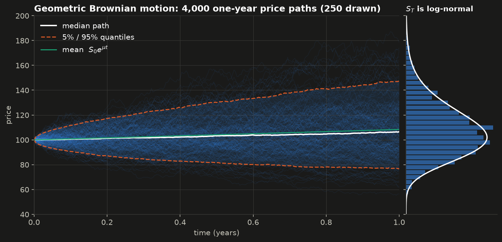
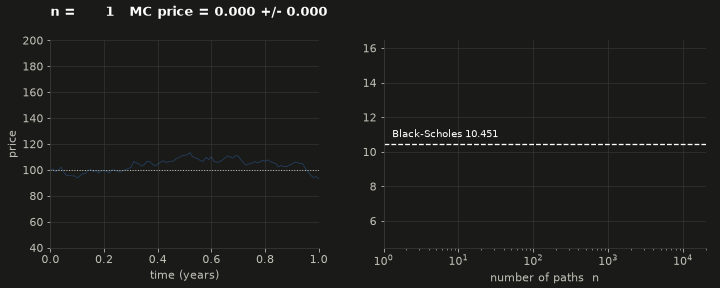
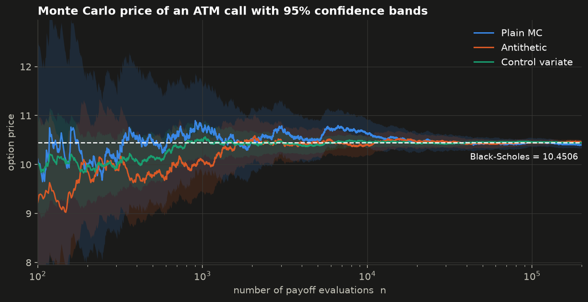
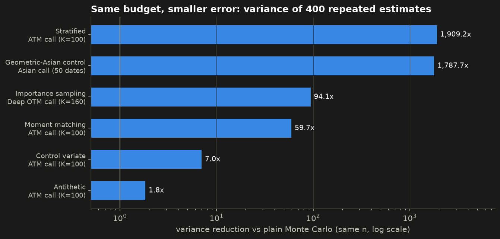
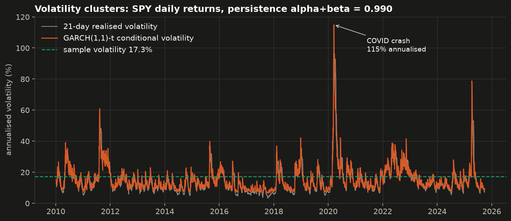
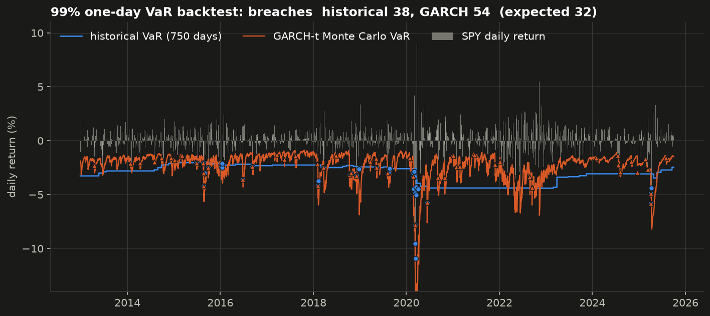
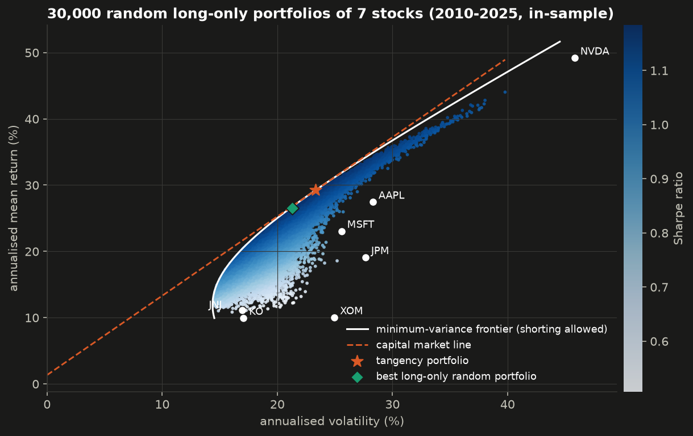

# Monte Carlo methods in finance

Simulated price paths, option prices, variance reduction, GARCH volatility and Value at Risk, in clean and tested Python. All numbers below come from `python scripts/run_all.py`.



> **A study project.** I built this while taking the *Monte Carlo methods* and *Securities* courses in the Financial Engineering program at Riga Technical University (RTU). The code is my own: some parts are cleaned-up versions of my lab code, and some are new implementations of topics I had only as notes (see [Where the code comes from](#where-the-code-comes-from)). It is for learning. It is not investment advice.

## What is inside

| Topic | What the code does | Key result |
|---|---|---|
| Random numbers | Park-Miller LCG and Box-Muller, from scratch | Matches the published Park-Miller check value |
| GBM | Exact simulation of Brownian motion and geometric Brownian motion | Hero image above |
| Option pricing | Monte Carlo vs the Black-Scholes formula | MC converges to 10.4506 at rate $1/\sqrt{n}$ |
| Variance reduction | Antithetic, control variate, moment matching, stratified, importance sampling | Up to **1,900x** less variance at the same $n$ |
| Path-dependent options | Asian call (geometric control variate), lookback call (discretisation bias) | Bias of a lookback price shrinks from -3.37 to -0.31 |
| GARCH(1,1) | Fit to SPY daily returns 2010-2025 with Student-t shocks | Persistence $\alpha+\beta = 0.990$ |
| VaR and ES | Historical, normal and GARCH Monte Carlo VaR, rolling backtest, Kupiec test | Historical 99% VaR passes; normal VaR fails |
| Portfolios | 30,000 random portfolios, efficient frontier, tangency portfolio, CAPM betas | Max Sharpe 1.20 (in-sample) |

<p align="center"></p>

## 1. Monte Carlo price vs Black-Scholes

Under the risk-neutral measure the stock follows geometric Brownian motion, and the final price has an exact form:

$$S_T = S_0 \exp\left(\left(r - \tfrac{1}{2}\sigma^2\right)T + \sigma\sqrt{T}\,Z\right), \qquad Z \sim N(0,1).$$

The option price is a discounted expectation, so Monte Carlo estimates it with an average:

$$C = e^{-rT}\,\mathbb{E}\left[(S_T-K)^+\right] \approx \frac{1}{n}\sum_{i=1}^{n} e^{-rT}(S_T^{(i)}-K)^+, \qquad \mathrm{SE} = \frac{s}{\sqrt{n}}.$$

The standard error falls like $1/\sqrt{n}$: 100 times more paths give only 10 times more accuracy. That is why variance reduction matters.

Test option in all examples: $S_0 = K = 100$, $r = 5\%$, $\sigma = 20\%$, $T = 1$. Black-Scholes call = **10.4506**, put = **5.5735**.



## 2. Variance reduction

Each method estimates the same price with $n = 10{,}000$ payoffs. I repeated each estimate 400 times and measured the spread of the results. *Variance reduction* = variance of plain MC / variance of the method. *Efficiency gain* also includes run time (variance x time), so it is the fair comparison.

| Option | Method | Mean of 400 estimates | SD of one estimate | Variance reduction | Efficiency gain |
|---|---|---:|---:|---:|---:|
| ATM call (exact 10.4506) | Plain MC | 10.4613 | 0.1496 | 1.0x | 1.0x |
| | Antithetic $(Z, -Z)$ | 10.4570 | 0.1104 | 1.8x | 2.7x |
| | Control variate $e^{-rT}S_T$ | 10.4515 | 0.0564 | 7.0x | 5.0x |
| | Moment matching | 10.4531 | 0.0194 | 59.7x | 48.7x |
| | Stratified (1,000 strata) | 10.4508 | 0.0034 | 1,909x | 796x |
| Deep OTM call, $K=160$ (exact 0.15895) | Plain MC | 0.1580 | 0.0182 | 1.0x | 1.0x |
| | Importance sampling | 0.1590 | 0.0019 | 94x | 85x |
| Arithmetic Asian call, 50 dates | Plain MC | 5.8536 | 0.0881 | 1.0x | 1.0x |
| | Geometric Asian as control | 5.8580 | 0.0021 | 1,788x | 1,477x |



How each method works, in one line:

- **Antithetic variates.** Use each normal twice, as $Z$ and $-Z$. The pair mean has variance $\tfrac{1}{2}(\mathrm{Var}\,Y + \mathrm{Cov}(Y, Y'))$, which is small when the payoff is monotone in $Z$.
- **Control variate.** Subtract a correlated quantity with a known mean: $Y - b(X - \mathbb{E}X)$ with $b = \mathrm{Cov}(Y,X)/\mathrm{Var}(X)$. The variance falls by the factor $1-\rho^2$.
- **Moment matching.** Rescale the normals so that their sample mean is 0 and their sample variance is 1 exactly.
- **Stratified sampling.** Split $U = \Phi(Z)$ into 1,000 equal strata and sample each one. No region of the distribution is over- or under-sampled.
- **Importance sampling.** Draw $Z \sim N(\theta, 1)$ so that more paths finish in the money, and reweight each payoff by the likelihood ratio $e^{-\theta Z + \theta^2/2}$.
- **Geometric Asian control.** The geometric average of GBM prices is log-normal, so its option has a closed-form price. Its correlation with the arithmetic Asian is about 0.9997.

### Discretisation bias: the lookback call

A fixed-strike lookback call pays $(\max_t S_t - K)^+$. A simulation can only check the price at grid dates, so it misses peaks between them and the estimate is **biased low**. The exact continuous-monitoring price is 19.1676 (40,000 paths per row):

| Monitoring dates per year | MC estimate | Standard error | Bias |
|---:|---:|---:|---:|
| 12 | 15.799 | 0.075 | -3.368 |
| 52 | 17.371 | 0.076 | -1.797 |
| 252 | 18.234 | 0.077 | -0.934 |
| 1,000 | 18.861 | 0.078 | -0.306 |

More paths make the standard error smaller, but they do not remove the bias. This is the bias-variance trade-off: $\mathrm{MSE} = \mathrm{bias}^2 + \mathrm{variance}$.

## 3. GARCH(1,1) volatility

Daily returns are not i.i.d. normal. Calm and wild periods form clusters. GARCH(1,1) models the variance of tomorrow's return from today's shock and today's variance:

$$r_t = \mu + \varepsilon_t,\quad \varepsilon_t = \sigma_t z_t,\qquad \sigma_t^2 = \omega + \alpha\,\varepsilon_{t-1}^2 + \beta\,\sigma_{t-1}^2 .$$

Fit to SPY (S&P 500 ETF) daily returns, 2010-01-05 to 2025-09-30, with Student-t shocks (`arch` package, returns in %):

| $\mu$ | $\omega$ | $\alpha$ | $\beta$ | $\alpha+\beta$ | t degrees of freedom $\nu$ | Shock half-life |
|---:|---:|---:|---:|---:|---:|---:|
| 0.105 | 0.0252 | 0.171 | 0.820 | 0.990 | 5.5 | 71 days |



The persistence is close to 1, so a volatility shock fades slowly. The model's implied long-run level $\sqrt{252\,\omega/(1-\alpha-\beta)} = 25.6\%$ is above the sample volatility of 17.3%. With $\alpha+\beta$ this close to 1, that ratio is very sensitive to small changes in the estimates, so I do not trust it as a forecast.

**Are returns normal?** No. A Kolmogorov-Smirnov test against a fitted normal rejects normality in all three parts of the sample:

| Period | Annual vol | Excess kurtosis | KS statistic | p-value |
|---|---:|---:|---:|---:|
| 2010-01 to 2015-04 | 15.8% | 4.2 | 0.081 | 5e-08 |
| 2015-04 to 2020-06 | 18.7% | 18.1 | 0.149 | 3e-26 |
| 2020-06 to 2025-09 | 17.2% | 8.4 | 0.067 | 1e-05 |

Fat tails like these are the reason the next section compares a normal VaR with models that do not assume normality.

## 4. Value at Risk and Expected Shortfall

For a confidence level $\alpha = 99\%$, VaR is the loss that is exceeded on only 1% of days, and Expected Shortfall is the average loss on those days:

$$\mathrm{VaR}_\alpha = q_\alpha(L), \qquad \mathrm{ES}_\alpha = \mathbb{E}\left[L \mid L \ge \mathrm{VaR}_\alpha\right], \qquad L = -r .$$

Three one-day 99% VaR models, each forecast out of sample from a rolling 750-day window:

- **Historical simulation**: the empirical 1% quantile of the last 750 returns.
- **Normal (parametric)**: $-\mu + 2.326\,\sigma$ from the last 750 returns.
- **GARCH-t Monte Carlo**: refit GARCH(1,1)-t every 20 days, simulate 100,000 next-day returns $\mu + \sigma_{t+1} z$ from the fitted model, and take their quantile.

Backtest over 3,209 trading days (2012-12-27 to 2025-09-30). The model is right on average if about 1% of days are breaches (32 days). The Kupiec test checks this:

| Model | Breaches | Breach rate | Kupiec LR | p-value | Verdict at 5% | Average VaR | Average ES |
|---|---:|---:|---:|---:|---|---:|---:|
| Historical | 38 | 1.18% | 1.04 | 0.31 | pass | 3.04% | 4.12% |
| Normal | 69 | 2.15% | 32.26 | <0.001 | **reject** | 2.39% | 2.74% |
| GARCH-t Monte Carlo | 54 | 1.68% | 12.54 | <0.001 | **reject** | 2.31% | 3.00% |



What I learned from this:

- The **normal model fails**. It has twice the expected number of breaches because it ignores fat tails.
- **Historical VaR passes** the coverage test, but it moves in slow steps and keeps a high VaR long after a crisis ends (2020-2023 in the chart).
- **GARCH reacts within days**, which is what a risk manager wants, but it breaches too often in calm years. Plain GARCH treats up and down moves the same. Real markets get more volatile after falls (the leverage effect), so an asymmetric model such as GJR-GARCH is the natural next step.

## 5. Portfolios, Sharpe ratio and CAPM

From my Securities course: mean-variance portfolios, the Sharpe ratio $\left(\mathbb{E}[r_p] - r_f\right)/\sigma_p$, and the CAPM regression $r_i - r_f = \alpha_i + \beta_i (r_M - r_f) + \varepsilon_i$. Data: 7 stocks, daily returns 2010-2025, market = SPY, risk-free rate = 13-week T-bill (mean 1.33%).



The Monte Carlo cloud of 30,000 random long-only portfolios fills the area under the analytic frontier. The best random portfolio (Sharpe 1.18) is close to the tangency portfolio (Sharpe 1.20, which shorts XOM). These are **in-sample** numbers. NVDA's large past return dominates them, so they say nothing about the future.

| Stock | Beta | Annual alpha | $R^2$ | Annual return | Annual vol | Sharpe |
|---|---:|---:|---:|---:|---:|---:|
| AAPL | 1.13 | 11.1% | 0.48 | 27.4% | 28.3% | 0.92 |
| MSFT | 1.11 | 7.0% | 0.57 | 23.1% | 25.6% | 0.85 |
| JPM | 1.18 | 2.1% | 0.54 | 19.1% | 27.7% | 0.64 |
| XOM | 0.86 | -2.7% | 0.35 | 10.0% | 25.0% | 0.35 |
| JNJ | 0.52 | 2.8% | 0.29 | 11.1% | 16.9% | 0.58 |
| KO | 0.56 | 1.2% | 0.32 | 9.9% | 17.1% | 0.50 |
| NVDA | 1.67 | 25.7% | 0.40 | 49.2% | 45.8% | 1.04 |

The defensive stocks (JNJ, KO) have betas near 0.5. NVDA has the highest beta, and its large alpha shows that CAPM does not explain its past return.

## How to run

```bash
git clone https://github.com/ilyaeis/monte-carlo-finance.git
cd monte-carlo-finance
python -m venv .venv && source .venv/bin/activate
pip install -r requirements.txt
pip install -e .               # makes `import mcfin` work everywhere

python scripts/run_all.py      # all figures, the GIF and results/results.json (~30 s)
python -m pytest               # 16 tests
python scripts/fetch_data.py   # optional: download fresh prices with yfinance
```

Small example:

```python
import numpy as np
from mcfin.black_scholes import bs_price
from mcfin.mc_pricing import price_plain, price_antithetic

rng = np.random.default_rng(0)
print(bs_price(100, 100, 1, 0.05, 0.2))                      # 10.4506
print(price_antithetic(100, 100, 1, 0.05, 0.2, 100_000, rng)) # MCResult(price=..., se=..., n=100000)
```

## Project layout

```
src/mcfin/
  rng.py            LCG (Park-Miller) and Box-Muller
  gbm.py            Brownian motion and GBM paths
  black_scholes.py  closed forms: European, geometric Asian, lookback
  mc_pricing.py     Monte Carlo estimators and variance reduction
  garch.py          GARCH(1,1) fit and simulation
  risk.py           VaR, ES, rolling backtest, Kupiec test, KS normality test
  portfolio.py      random portfolios, frontier, tangency, CAPM
scripts/
  run_all.py        runs every experiment, writes figures/ and results/
  fetch_data.py     refreshes data/prices.csv
tests/              pytest: MC prices inside the confidence interval, parity, VaR, ...
data/prices.csv     daily adjusted closes 2010-2025 (yfinance, 0.3 MB)
```

## Where the code comes from

- **From my lab work, cleaned up:** the LCG lab (`rng.py`), the Brownian motion / GBM lab with Box-Muller (`gbm.py`), the Monte Carlo vs Black-Scholes lab (`mc_pricing.price_plain`), the lookback bias / MSE study, the KS normality test on three sub-periods, and the 750-day historical-simulation VaR with breach counting. My original VaR lab used a course data file; here the same method runs on public SPY data.
- **Rewritten from my notes (there was no code before):** the variance reduction methods as a common interface, GARCH fitting and the GARCH Monte Carlo VaR, the Kupiec test, the closed forms for geometric Asian and lookback options, and the whole portfolio / CAPM part.
- No lecture slides, assignment texts or exam material are included.

## License

MIT. See [LICENSE](LICENSE).

Part of my portfolio: https://ilyaeis.github.io/?go=monte-carlo
